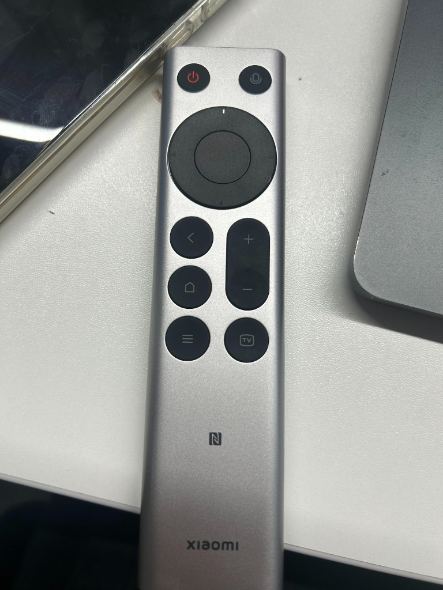

# mi-remote v2.0

**把几十元的小米蓝牙语音遥控器 2 / 2 Pro，变成 macOS 上单手盲操 Cursor Agent 与 Codex 的语音编码仙女棒。**

- 📖 **完整技术复刻与踩坑指南（可分享长文）**：[**`docs/GUIDE.md`**](docs/GUIDE.md)
- 💡 **致谢与对比**：灵感源自 [fanxeon/mi-ao](https://github.com/fanxeon/mi-ao)。区别在于本方案走 **「纯 BLE HID 硬件层精准接管 + 豆包输入法语音直通 + Cursor/Codex 双端适配」** 路线，零外部依赖（单文件 ~450 行原生 Swift），且将全部 13 个实体按键通过「单击 / 双击 / 长按 / 组合键」四层手势 +「⌨️ 方向键 ↔ 🖱 60fps 鼠标指针」双模式 100% 利用起来。

<p align="center">
  
</p>

---

## 实物分区与按键速查表

```text
        ┌─────────────────────────┐
        │   (⏻)红           (🎤)   │  ← 顶部：Esc 中断/取消  |  按住豆包语音
        │                         │
        │         ╭─────╮         │
        │       ╭─┤  ↑  ├─╮       │
        │       │←│ OK  │→│       │  ← 圆环：方向键 / 60fps 鼠标指针 | OK 发送/点击(长按换行/右键)
        │       ╰─┤  ↓  ├─╯       │
        │         ╰─────╯         │
        │    (<)           (+)    │  ← 左上 <：单击/按住=退格⌫，双击=清空整框重说(⌘A+⌫)
        │                  │ │    │  ← 右侧 ±：单击=上下切会话，长按=上下翻页(PageUp/Down)
        │    (⌂)           (−)    │  ← 左中 ⌂：单击=聚焦当前输入框，双击=新建对话(⌘N)，长按=侧栏(⌘B)
        │                         │
        │    (≡)          ([TV])  │  ← 左下 ≡：单击切换 ⌨️/🖱 模式，双击光标归中，按住+方向=2D滚屏
        └─────────────────────────┘  ← 右下 TV：单击切 Cursor↔Codex 并聚焦输入框，双击回上个外部应用
```

| 分区 | 实体按键 | Usage | 单击 (Tap) | 双击 (≤260ms) | 长按 / 按住 (≥360ms) |
| --- | --- | --- | --- | --- | --- |
| **顶部右** | **`🎤` 麦克风** | `0x3E` | — | — | **按住说话、松手上屏**（`Option+F5` 触发豆包输入法听写） |
| **顶部左** | **`⏻` 红电源** | `0x66` | **`Esc`**（中断生成 / 关弹窗 / 取消） | **连发 `Esc × 2`** | **`⌃C + Esc` 强制中断** |
| **圆环** | **`↑ ↓ ← →`** | `0x52` `0x51` `0x50` `0x4F` | **⌨️ 方向模式**：上下左右方向键<br>**🖱 鼠标模式**：精准微移指针 | — | **⌨️ 方向模式**：按住连发方向键<br>**🖱 鼠标模式**：60fps 渐进加速移鼠（支持斜向双键同按） |
| **圆环中** | **`OK` 确认键** | `0x28` | **⌨️ 方向模式**：`Return ⏎`（发送/确认）<br>**🖱 鼠标模式**：鼠标左键单击 | **🖱 鼠标模式**：鼠标左键双击 | **⌨️ 方向模式**：**`⇧Return`（输入框内换行不发送）**<br>**🖱 鼠标模式**：鼠标右键点击 |
| **左列上** | **`<` 返回键** | `0xF1` | **`⌫` 退格删 1 字（0 延迟）** | **一键清空整框重说**（`⌘A` + `⌫`） | **按住连续快删**（每秒 ~18 字，松手立停） |
| **左列中** | **`⌂` 小房子** | `0x4A` | **聚焦当前 App 的对话输入框**（Cursor `⌘L` / Codex `⌘;`） | **新建对话 / 会话**（`⌘N`） | **展开/收起侧边栏**（`⌘B`） |
| **左列下** | **`≡` 三横线** | `0x65` | **切换「⌨️ 方向键模式 ↔ 🖱 鼠标指针模式」** | **光标归中**（瞬移至主屏中央并进鼠标模式） | **按住 `≡` + 方向键**：任意模式下直接上下左右滚屏 |
| **右列上** | **`+ / −` 音量键** | `0x80` `0x81` | **下一个 / 上一个会话**（Cursor `⌘⌥↑/↓` 切换器提交；Codex `⌘⌥←/→`） | — | **按住连续翻页**（`PageUp` / `PageDown`） |
| **右列下** | **`[TV]` 屏幕键** | `0x35` | **Cursor ↔ Codex 切屏 + 自动聚焦输入框** | **切回上一个外部应用**（如浏览器/终端） | **仅切屏（不改焦点）** |

---

## 3 分钟快速开始

1. **蓝牙配对**：同时长按遥控器 `<` + `⌂` 5 秒进入配对，在 macOS 蓝牙设置中连接 `小米蓝牙语音遥控器`。
2. **构建安装**：
   ```bash
   ./install.sh
   ```
3. **系统授权**：在「系统设置 → 隐私与安全性」的 **辅助功能** 与 **输入监控** 中添加并开启 `~/Applications/MiRemote.app`，然后执行：
   ```bash
   launchctl kickstart -k gui/$(id -u)/com.miremote.daemon
   ```
4. **绑定语音与聚焦快捷键**：
   - 在**豆包输入法**设置中，将语音快捷键自定义录制为按一下遥控器 `🎤` 语音键（即 `Option+F5`），模式选「长按」。
   - 在 **Codex** 快捷键设置中，将「聚焦主聊天输入框」设为 `⌘;`（Cursor 默认使用 `⌘L`）。

---

## 仓库目录结构

```text
mi-remote/
├── Sources/
│   └── main.swift          # 核心守护进程（hidutil 隔离 + IOHIDManager + 手势引擎 + HUD + 状态栏）
├── scripts/
│   └── probe-hid.swift     # 独立硬件 HID 键码探测工具（swift scripts/probe-hid.swift）
├── docs/
│   ├── GUIDE.md            # 可复刻、可分享的完整技术方案与六大踩坑实录
│   └── assets/
│       └── xiaomi-remote-2.jpg
├── build.sh                # 编译并打包签名 MiRemote.app
├── install.sh              # 安装到 ~/Applications + 生成默认配置 + 注册 LaunchAgent
├── uninstall.sh            # 一键停止服务、清理文件并恢复遥控器出厂映射
└── README.md
```
