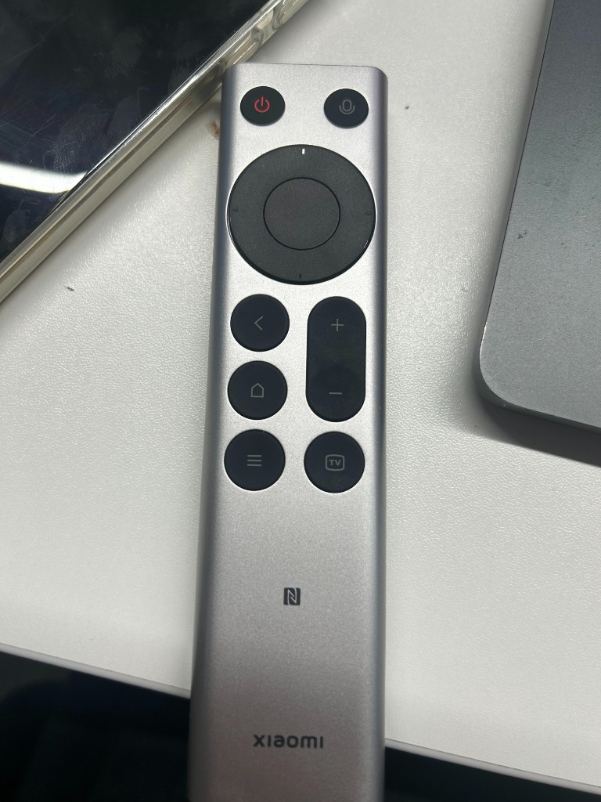

# 把小米蓝牙遥控器 2 变成 Cursor & Codex 的 Vibe Coding 语音仙女棒：完整复刻与踩坑指南

> **一句话简介**：只需一支几十元的小米蓝牙语音遥控器 2（或 2 Pro）+ 豆包输入法 + 约 450 行原生 Swift 守护进程，就能在 macOS 上实现 **单手盲操 Cursor Agent 与 Codex 桌面端**：按住说话、松手上屏、一键发送/换行、双击秒清错句、上下切会话、一键切屏并自动落点输入框，还能随时在「⌨️ 方向键模式」与「🖱 60fps 鼠标指针模式」之间无缝切换。

<p align="center">
  
</p>

---

## 目录

1. [为什么做这个方案（对比 `fanxeon/mi-ao`）](#1-为什么做这个方案对比-fanxeonmi-ao)
2. [硬件兼容性与真机实测结论](#2-硬件兼容性与真机实测结论)
3. [基于实物排布与图标语义的 13 键满配方案](#3-基于实物排布与图标语义的-13-键满配方案)
4. [核心技术架构（三层解耦设计）](#4-核心技术架构三层解耦设计)
5. [六大底层踩坑实录（复刻必读）](#5-六大底层踩坑实录复刻必读)
6. [从零复刻完整步骤（5 分钟搞定）](#6-从零复刻完整步骤5-分钟搞定)
7. [进阶自定义：修改快捷键与适配其他工具](#7-进阶自定义修改快捷键与适配其他工具)

---

## 1. 为什么做这个方案（对比 `fanxeon/mi-ao`）

开源项目 [fanxeon/mi-ao](https://github.com/fanxeon/mi-ao) 提出了一个极具创意的想法：把小米蓝牙遥控器 2 Pro 变成 macOS 上控制 Codex 的语音遥控器。

但在实际复刻与日常高强度使用中，如果你同时使用 **Cursor** 和 **Codex**，且电脑上已经装了**豆包输入法**（或其他高质量语音输入法），直接走 `mi-ao` 的路线会有几个明显痛点：

| 维度 | `fanxeon/mi-ao` 原仓库方案 | 本方案 (`mi-remote` + 豆包输入法) |
| --- | --- | --- |
| **语音链路** | 逆向 BLE GATT ATVV 协议 → ADPCM 解码 → 本地 `whisper.cpp` 转写 → 通过 AX 树塞入 Codex | 遥控器语音键硬件级映射为 `Option+F5` → 直接触发**豆包输入法**「按住说话，松手上屏」 |
| **识别准确率与速度** | 本地 Whisper base 模型对中英混杂的技术术语（如 `useEffect`、`hidutil`、组件名）容易误识别，且松手后有转写延迟 | 豆包输入法原生支持流式实时上屏、中英混输、代码术语纠错，松手瞬间上屏 |
| **支持的目标应用** | 强绑定 `Codex.app`（且需带 `--force-renderer-accessibility` 参数启动） | **通吃所有应用**（原生深度适配 **Cursor** + **Codex** 双端互切、聚焦输入框与会话切换） |
| **按键利用率** | 菜单键 `≡` 闲置，返回键固定 `Esc`，没有退格删字与一键清空 | **全 13 键 100% 榨干**：引入**单击 / 双击 / 长按 / 组合键**四层手势，兼顾删字、清空、换行、新建会话、滚屏、切模式 |
| **工程复杂度** | 30+ 个 Swift 源文件 + Homebrew 依赖 + 数百 MB Whisper 模型 | **单文件 ~450 行原生 Swift**，零第三方依赖，`swiftc` 2 秒编译出 `.app` |

---

## 2. 硬件兼容性与真机实测结论

很多人手头只有普通版 **「小米蓝牙语音遥控器 2」**（电视/盒子标配版，带 NFC 标），不确定能不能复刻标称需要「2 Pro」的 `mi-ao`。

**真机实测结论：完全兼容，硬件身份 100% 一致！**

在 macOS 下通过 `system_profiler SPBluetoothDataType` 与 `IOHIDManager` 实测，普通版「小米遥控器 2」向系统报告的参数与 `mi-ao` 中的 2 Pro 档案逐字吻合：

- **蓝牙设备名**：`小米蓝牙语音遥控器`
- **Vendor ID (VID)**：`0x2717`（十进制 `10007`，小米）
- **Product ID (PID)**：`0x32B8`（十进制 `12984`）
- **Firmware Version**：`2671`
- **传输协议**：`Bluetooth Low Energy (BLE)`

### 13 个实体按键原始 HID Usage 实测表

全部按键均在 **HID Usage Page `0x07` (Keyboard/Keypad)** 下上报按下（`value=1`）和松开（`value=0`）：

| 实体按键 | 十六进制 Usage | 十进制 Usage | macOS 原始默认行为（未接管前） |
| --- | --- | --- | --- |
| 方向上 `↑` | `0x52` | `82` | 向上方向键 |
| 方向下 `↓` | `0x51` | `81` | 向下方向键 |
| 方向左 `←` | `0x50` | `80` | 向左方向键 |
| 方向右 `→` | `0x4F` | `79` | 向右方向键 |
| 中心确认 `OK` | `0x28` | `40` | `Return` 回车键 |
| 返回 `<` | `0xF1` | `241` | **非标准 Usage，macOS 直接丢弃（无任何反应）** |
| 主页 `⌂` (Home) | `0x4A` | `74` | `Home` 键 |
| 菜单 `≡` | `0x65` | `101` | `Keyboard Application`（macOS 下无实际作用） |
| 电视 `[TV]` | `0x35` | `53` | 墓音符/反引号 `` ` ``（会在编辑器里乱打字符） |
| 电源 `⏻` | `0x66` | `102` | `Keyboard Power`（长按会触发 Mac 锁屏/睡眠弹窗） |
| 语音 `🎤` | `0x3E` | `62` | `F5` 功能键 |
| 音量加 `+` | `0x80` | `128` | 系统音量调大 |
| 音量减 `−` | `0x81` | `129` | 系统音量调小 |

> **如何自检手头的遥控器？**
> 蓝牙连接遥控器后，运行本仓库自带的探测脚本：
> ```bash
> swift scripts/probe-hid.swift
> ```
> 依次按遥控器各键，终端会实时打印 `page`、`usage` 和按下/松开状态。

---

## 3. 基于实物排布与图标语义的 13 键满配方案

对照遥控器的物理分区（顶部双键 → 拇指圆环 → 左右双列功能键），我们将高频编码动作按照**图标本义**与**肌肉直觉**做了如下映射：

```text
        ┌─────────────────────────┐
        │   (⏻)红           (🎤)   │  ← 顶部：Esc 中断/取消  |  按住豆包语音
        │                         │
        │         ╭─────╮         │
        │       ╭─┤  ↑  ├─╮       │
        │       │←│ OK  │→│       │  ← 圆环：方向键 / 60fps 鼠标指针 | OK 发送/点击(长按换行/右键)
        │       ╰─┤  ↓  ├─╯       │
        │         ╰─────╯         │
        │    (<)           (+)    │  ← 左上 <：单击/按住=退格⌫，双击=清空整框重说(⌘A+⌫)
        │                  │ │    │  ← 右侧 ±：单击=上下切会话，长按=上下翻页(PageUp/Down)
        │    (⌂)           (−)    │  ← 左中 ⌂：单击=聚焦当前输入框，双击=新建对话(⌘N)，长按=侧栏(⌘B)
        │                         │
        │    (≡)          ([TV])  │  ← 左下 ≡：单击切换 ⌨️/🖱 模式，双击光标归中，按住+方向=2D滚屏
        └─────────────────────────┘  ← 右下 TV：单击切 Cursor↔Codex 并聚焦输入框，双击回上个外部应用
```

### 完整手势矩阵

| 分区 | 实体按键 | 单击 (Tap) | 双击 (≤260ms) | 长按 / 按住 (≥360ms) | 设计考量与语义 |
| --- | --- | --- | --- | --- | --- |
| **顶部右** | **`🎤` 麦克风** | — | — | **按住说话，松手上屏** | 拇指右上最顺手位，完美匹配豆包输入法长按说话 |
| **顶部左** | **`⏻` 红电源** | **`Esc`**（中断生成/关弹窗） | **连发 `Esc × 2`** | **`⌃C + Esc` 强制中断** | 红色图标天然代表「Stop / 取消」，补齐 `<` 改为退格后的 `Esc` 缺口 |
| **圆环** | **`↑ ↓ ← →`** | **⌨️ 方向模式**：方向键<br>**🖱 鼠标模式**：微移指针 | — | **⌨️ 方向模式**：按住连发方向键<br>**🖱 鼠标模式**：60fps 渐进加速移鼠（支持斜向同按） | 初速 220px/s 精准微调，按住平滑加速至 1050px/s 快速跨屏 |
| **圆环中** | **`OK` 确认键** | **⌨️**：`Return ⏎` 发送<br>**🖱**：鼠标左键单击 | **🖱**：鼠标左键双击 | **⌨️**：**`⇧Return` 换行不发送**<br>**🖱**：鼠标右键点击 | 说完话拇指自然下移按 `OK` 发送；想分段补充时按住 `OK` 即可换行 |
| **左列上** | **`<` 返回键** | **`⌫` 退格删 1 字（0 延迟）** | **一键清空整框**（`⌘A + ⌫`） | **按住连续快删**（~18字/秒） | 语音识别错一两个字单击/长按删；整句说歪直接**双击秒清重说** |
| **左列中** | **`⌂` 小房子** | **聚焦当前 App 输入框**（Cursor `⌘L` / Codex `⌘;`） | **新建对话 / 会话**（`⌘N`） | **展开/收起侧边栏**（`⌘B`） | 小房子 =「回主基地（输入框）」；双击 =「开新房间（New Chat）」 |
| **左列下** | **`≡` 三横线** | **切换 `⌨️ 方向模式 ↔ 🖱 鼠标模式`** | **光标归中**（瞬移至屏幕正中并进鼠标模式） | **按住 `≡` + 方向键**：任意模式下直接 2D 滚屏 | 把原本无用的菜单键变成模式中枢；按住它配方向键还能随时滚屏看代码 |
| **右列上** | **`+ / −` 摇杆** | **下一个 / 上一个会话** | — | **按住连续翻页**（`PageUp` / `PageDown`） | 竖条摇杆天生适合「上下切左侧会话列表 + 长按上下翻长文」 |
| **右列下** | **`[TV]` 屏幕键** | **Cursor ↔ Codex 切屏 + 自动聚焦输入框** | **切回上一个外部应用**（如浏览器/终端） | **仅切屏（不改焦点）** | 显示器图标 = 切屏；切过去自动落点输入框，拿起遥控器直接开说 |

---

## 4. 核心技术架构（三层解耦设计）

为了让遥控器**既不触发 macOS 原生副作用，又完全不污染 Mac 自带键盘**，系统分为三层：

```text
小米蓝牙语音遥控器 (VID 0x2717 / PID 0x32B8)
  │
  ├──► [Layer 1: hidutil 设备级隔离层]
  │      ├─ 语音键 (0x3E) ────────────► 映射为 Right Option (0xE6)
  │      │                              └─► 系统收到 Option+F5 ─► 触发豆包输入法按住说话
  │      └─ 其余 12 个实体键 ─────────► 全部映射为 No Event (0x700000000)
  │                                     └─► 彻底屏蔽系统休眠、音量、反引号等原生副作用
  │
  └──► [Layer 2: IOHIDManager 硬件直连层] (仅匹配 VID 0x2717 / PID 0x32B8)
         │  （不受 hidutil No Event 影响，照常收到全部 13 键原始按下 value=1 / 松开 value=0）
         ▼
       [Layer 3: ControllerEngine 多手势与双模式引擎 (60Hz)]
         ├─ 单击 / 双击仲裁器 (260ms) + 长按计时器 (360ms) + 连发状态机
         ├─ AppNavigator：追踪前台应用，驱动 Cursor/Codex 激活、聚焦与会话切换
         ├─ 60fps 渐进加速指针移动 & CGEvent 键盘/鼠标/滚轮合成
         └─ 非抢焦点毛玻璃 HUD 浮层 (NSPanel) + 状态栏图标 (NSStatusItem ⌨️/🖱)
```

---

## 5. 六大底层踩坑实录（复刻必读）

在开发与真机调试过程中，我们踩遍了 macOS HID 驱动、Quartz 事件合成和 TCC 权限的坑，全部有真机日志验证。第三方复刻或二次开发时请务必注意：

### 坑 1：`hidutil` 把按键映射到修饰键时是「叠加」而非「替换」！
- **现象**：豆包输入法默认快捷键是「长按右 Command」。如果我们用 `hidutil` 把遥控器语音键（原始码 `0x3E`，即 `F5`）映射为 `Right Command (0xE7)`，按下语音键时系统并不会只收到 `Right Command`，而是收到 **`Command + F5` 连发**！在 macOS 中 `⌘F5` 是系统级「打开旁白 (VoiceOver)」快捷键，一按就会弹出旁白确认框。
- **另外**：如果把语音键映射为普通功能键（如 `F9`），豆包输入法会报错「*可使用 fn/control/option/command 中的单键或组合键*」，不允许录制纯单键。
- **正解**：用 `hidutil` 将语音键 `0x3E` 映射为 **`Right Option (0xE6)`**。此时按下遥控器语音键，系统稳定收到 **`Option + F5` (`⌥F5`)** 组合键——既不触发任何 macOS 系统功能，又刚好满足豆包输入法对「修饰键组合」的要求，按住说话、松手结束完美丝滑！

### 坑 2：返回键 `<` (`0xF1`) 是非标准 Usage，`hidutil` 映射完全无效
- **现象**：遥控器的返回键上报 `UsagePage 0x07, Usage 0xF1`。在 `hidutil` 中把 `0x7000000F1` 映射成 `Escape (0x29)` 或 `Backspace (0x2A)`，映射表能写入成功，但按键毫无反应。
- **根因**：macOS 的 `AppleUserHIDEventDriver` 将 `0xF1` 视为未定义键盘 Usage，在进入 `UserKeyMapping` 转换及生成 `CGEvent` 之前就直接丢弃了。
- **正解**：必须使用 `IOHIDManager` 直接订阅遥控器的原始 HID 报告，在收到 `usage == 0xF1` 时通过 `CGEvent` 合成 `Backspace (keycode 51)`。

### 坑 3：`hidutil` 的 `0x700000000` (`No Event`) 隔离法比 `CGEventTap` 优雅得多
- **现象**：如果用 `hidutil` 把遥控器按键映射到 `F14/F15` 再用 `CGEventTap` 拦截，会发现 `F14/F15` 在 macOS 中硬编码了屏幕亮度增减，会话层 `CGEventTap` 根本拦不住；而如果换成 `F16–F20`，虽然能拦住，但一旦你在 Mac 键盘上按 `F16–F20` 也会被误拦截。
- **正解**：借鉴 `mi-ao`，把除语音键外的 12 个实体键用 `hidutil` 全部映射到 **`0x700000000` (`No Event`)**。这样 macOS 键盘驱动层直接忽略它们，而 `IOHIDManager` 位于驱动映射层之下，依然能毫秒不差地拿到每个键的按下和松开，**既不需要 `CGEventTap`，也 0% 触碰 Mac 自身键盘**。

### 坑 4：Cursor 的会话切换（`⌘⌥↑/↓`）是「松开修饰键才提交」的模态切换器
- **现象**：在 Codex 中切换上下会话只需发送一次 `⌘⌥←` 或 `⌘⌥→`；但在 Cursor 中发送带 `[.maskCommand, .maskAlternate]` 的上下方向键时，左侧会话列表**只会移动高亮框，不会真正打开该会话**，哪怕后面紧跟发送 `Return` 回车键也无效。
- **根因**：Cursor 的会话切换器逻辑与 macOS 的 `⌘Tab` 相同——按住 `⌘⌥` 并按方向键只是预选，**检测到 `Command / Option` 修饰键物理释放（`flagsChanged` 归零）时才会提交切换**。
- **正解**：必须完整合成五步事件序列：
  1. `flagsChanged` 按下 `Command (keycode 55, flags: .maskCommand)`
  2. `flagsChanged` 按下 `Option (keycode 58, flags: [.maskCommand, .maskAlternate])`
  3. 发送 `ArrowUp / ArrowDown` 按下与松开
  4. `flagsChanged` 松开 `Option`
  5. `flagsChanged` 松开 `Command (flags: [])`

### 坑 5：`IOHIDManager` 必须全局强引用持有
- **现象**：如果在启动函数里写 `let manager = IOHIDManagerCreate(...)` 并注册 RunLoop，函数返回后 `IOHIDManagerOpen` 虽返回 `0 (Success)`，但按键回调永远不会触发。
- **正解**：必须用模块级全局变量 `var hidManager: IOHIDManager?` 强引用持有该实例，防止被 Swift ARC 提前释放。

### 坑 6：macOS TCC 权限与自签名证书陷阱
- **现象**：如果自己用 `openssl` 生成未受系统根证书信任的 `Self-Signed Certificate` 给 `.app` 签名，即使在「系统设置 → 辅助功能」里把开关打开，`AXIsProcessTrusted()` 依然返回 `false`。
- **正解**：本地编译直接使用标准 ad-hoc 签名（`codesign --force --sign -`），且构建脚本在将 `dist/MiRemote.app` 复制到 `~/Applications/MiRemote.app` 后应**立即删除 `dist/MiRemote.app`**，确保全盘只有一个 `MiRemote.app`，避免用户在系统权限文件选择框里选错副本。

---

## 6. 从零复刻完整步骤（5 分钟搞定）

### 第一步：遥控器蓝牙配对
1. 拿起小米蓝牙语音遥控器 2（或 2 Pro），同时长按 **「`<` 返回键 + `⌂` 小房子键」** 约 5 秒，直到遥控器顶部指示灯闪烁。
2. 打开 Mac **「系统设置 → 蓝牙」**，在附近设备中找到 **`小米蓝牙语音遥控器`** 并点击连接。

### 第二步：编译并安装守护进程
在终端执行：

```bash
git clone https://github.com/Snoopyjoy/mi-remote.git ~/projects/mi-remote
cd ~/projects/mi-remote
./install.sh
```

`./install.sh` 会自动完成三件事：
1. 调用 `swiftc -O` 编译 `Sources/main.swift`，生成并签名 `~/Applications/MiRemote.app`；
2. 生成默认配置文件 `~/.config/mi-remote/config.json`（若已存在则保留用户修改）；
3. 注册并启动 `~/Library/LaunchAgents/com.miremote.daemon.plist`（开机/登录自启，崩溃自动拉起）。

### 第三步：授予 macOS 权限（仅首次安装需操作一次）
打开 **「系统设置 → 隐私与安全性」**，分别在以下两个列表点击 **`+`** 号，按 `⌘⇧G` 输入 `~/Applications/MiRemote.app` 添加并开启开关：
1. **辅助功能 (Accessibility)**（用于合成快捷键与移动鼠标指针）
2. **输入监控 (Input Monitoring)**（用于 `IOHIDManager` 直接读取遥控器原始按键）

授权后在终端重启一次服务使其立即生效：
```bash
launchctl kickstart -k gui/$(id -u)/com.miremote.daemon
```
此时屏幕右上角菜单栏会出现 **`⌨️`** 图标，查看日志 `tail -n 10 ~/Library/Logs/mi-remote.log` 看到 `HID listener ready (all 13 buttons via IOHIDManager)` 即表示完全就绪。

### 第四步：配置豆包输入法与 Codex 快捷键
1. **豆包输入法设置**：
   - 打开豆包输入法设置（或运行 `open "/Library/Input Methods/DoubaoIme.app/Contents/Applications/DoubaoImeSettings.app"`）。
   - 找到 **「语音输入快捷键 / 全局语音快捷键」** → 选择自定义 → 点击录制框后**按一下遥控器右上角的 `🎤` 语音键**（此时会被识别并录入为 **`⌥F5` / `Option + F5`**），模式选择「长按说话」，保存。
2. **Codex 桌面端设置**：
   - 打开 Codex 设置 → 快捷键，将 **「聚焦主聊天输入框」** 设置为 **`⌘;`**（Command + 分号）。
   - Cursor 无需额外设置（默认使用 Cursor 原生的 **`⌘L`** 聚焦 Agent 输入框）。

---

## 7. 进阶自定义：修改快捷键与适配其他工具

日常调整双击速度、长按阈值或各应用的快捷键，**完全不需要重新编译代码，也不需要重新授权 TCC**。

直接编辑 `~/.config/mi-remote/config.json`：

```json
{
  "doubleClickMs": 260,
  "longPressMs": 360,
  "focusCombos": {
    "com.todesktop.230313mzl4w4u92": {"keycode": 37, "modifiers": ["command"]},
    "com.openai.codex": {"keycode": 41, "modifiers": ["command"]}
  },
  "newChatCombos": {
    "com.todesktop.230313mzl4w4u92": {"keycode": 45, "modifiers": ["command"]},
    "com.openai.codex": {"keycode": 45, "modifiers": ["command"]}
  },
  "sessionCombos": {
    "com.openai.codex": {
      "prev": {"keycode": 124, "modifiers": ["command", "option"]},
      "next": {"keycode": 123, "modifiers": ["command", "option"]}
    }
  }
}
```

改完后点击右上角菜单栏 `⌨️/🖱` 图标 → **「重新加载配置 (config.json)」** 即刻生效。

### 常用 macOS 虚拟键码 (CGKeyCode) 速查

| 按键 | `keycode` | 按键 | `keycode` | 按键 | `keycode` |
| --- | --- | --- | --- | --- | --- |
| `A` | `0` | `L` | `37` | `Return ⏎` | `36` |
| `B` | `11` | `N` | `45` | `Backspace ⌫` | `51` |
| `C` | `8` | `K` | `40` | `Escape ⎋` | `53` |
| `I` | `34` | `;` (分号) | `41` | `Space` | `49` |
| `[` | `33` | `]` | `30` | `PageUp / PageDown` | `116 / 121` |
| `← / →` | `123 / 124` | `↓ / ↑` | `125 / 126` | `Tab` | `48` |

### 一键卸载与恢复遥控器默认状态

```bash
cd ~/projects/mi-remote
./uninstall.sh
```
执行后会停止并移除 LaunchAgent、删除 `~/Applications/MiRemote.app`，并清空 `hidutil` 设备映射，遥控器立即恢复出厂默认行为。
